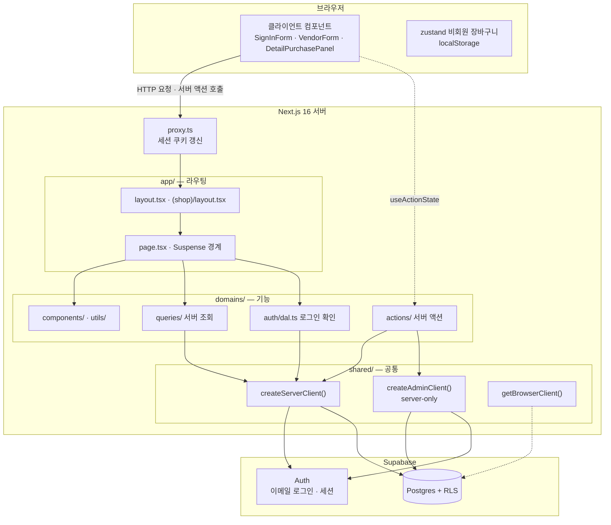
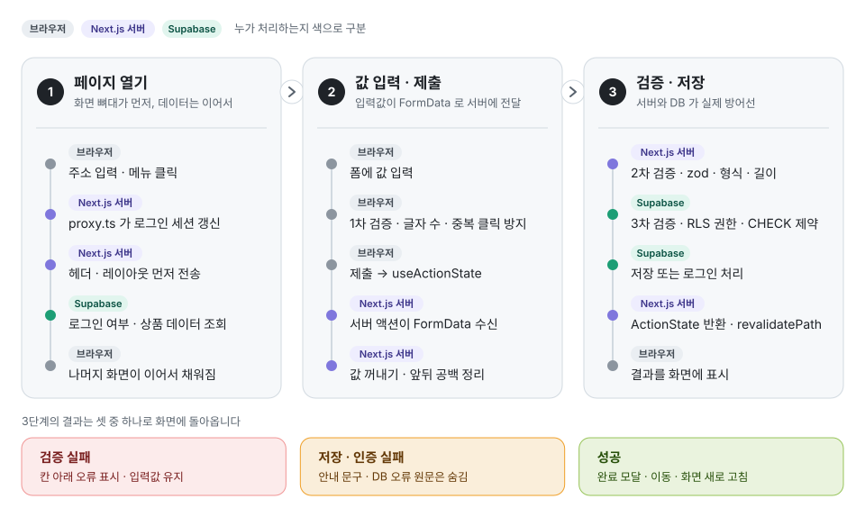
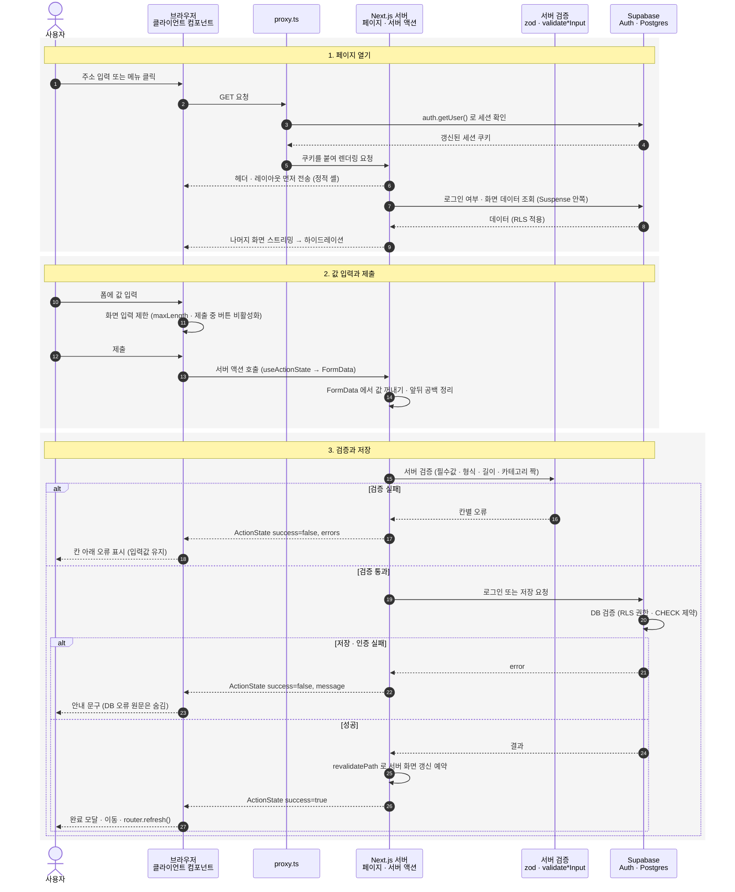

# MYSHOP — EQL 클론 쇼핑몰

EQL 온라인 편집숍을 참고해 만드는 PC 전용 쇼핑몰입니다.
Next.js 16(App Router)이 화면과 서버 로직을, Supabase가 회원 인증과 데이터 저장을 맡습니다.

- 팀 저장소: [kssk3/frontend_f_team_project](https://github.com/kssk3/frontend_f_team_project)
- 브랜치 흐름: `feat/*` · `fix/*` → `develop` → `main`

## 실행 방법

```bash
npm install
npm run dev   # http://localhost:3000
```

`.env.local` 에 `NEXT_PUBLIC_SUPABASE_URL`, `NEXT_PUBLIC_SUPABASE_PUBLISHABLE_KEY`, `SUPABASE_SERVICE_ROLE_KEY` 가 필요합니다. 값은 팀 Supabase 프로젝트에서 받습니다.

## 아키텍처

### 폴더 구조

```
shopping-mall/
├── proxy.ts                 # 모든 요청 앞단: Supabase 세션 쿠키 갱신 (Next 16의 middleware)
├── app/                     # 라우팅 전용 — URL ↔ 페이지 연결만 담당 (얇게 유지)
│   ├── layout.tsx           #   RootLayout: 폰트 · 전역 CSS
│   ├── (shop)/              #   쇼핑몰 화면 그룹 (Header · Footer · 준비 중 토스트)
│   │   ├── page.tsx         #     메인
│   │   ├── login/ member/   #     로그인 · 회원가입 · 계정 찾기 · 비회원 주문조회
│   │   ├── product/[id]/    #     상품 상세
│   │   ├── cart/            #     장바구니
│   │   └── help/vendor/     #     입점 문의
│   ├── (admin)/admin/       #   관리자 (빈 페이지)
│   └── _component/          #   Header · Footer · GNB · AuthMenu
├── domains/                 # 기능별 코드 — 실제 로직은 여기에
│   └── <auth|main|product|cart|vendor|checkout|order>/
│       ├── actions/         #   서버 액션 ('use server', 폼 제출 처리)
│       ├── queries/         #   서버 전용 조회 (server-only)
│       ├── components/      #   화면 조각
│       ├── types/ utils/    #   타입 · 순수 함수 (DB 행 → 화면 모양 변환 등)
│       └── dal.ts           #   (auth) 요청 시점 로그인 사용자 확인
├── shared/                  # 여러 도메인이 함께 쓰는 것
│   ├── lib/                 #   Supabase 연결 객체 (브라우저 · 서버 · 관리자 · proxy)
│   ├── components/          #   NavLink · ComingSoonProvider · ui/(shadcn)
│   ├── types/               #   ActionState (모든 서버 액션의 공통 반환 모양)
│   └── utils/ hooks/
└── db/                      # schema.sql(스냅샷) · migrations/
```

### 계층 구성도



### Supabase 연결 객체 4가지

| 이름 | 파일 | 실행 위치 | 권한 | 쓰는 곳 |
|---|---|---|---|---|
| `refreshSupabaseSession` | `shared/lib/supabaseProxy.ts` | proxy | 사용자 세션 | 모든 요청에서 쿠키 갱신 (권한 판단은 하지 않음) |
| `createServerClient()` | `shared/lib/supabase.ts` | 서버 컴포넌트 · 서버 액션 | 로그인 사용자 (RLS 적용) | 상품 조회 · 로그인 · 입점 문의 저장 |
| `getBrowserClient()` | `shared/lib/supabase.ts` | 브라우저 | publishable key (RLS 적용) | 현재 거의 사용하지 않음 |
| `createAdminClient()` | `shared/lib/supabaseAdmin.ts` | 서버 전용 | service role (**RLS 무시**) | 회원가입 프로필 저장 · 아이디/비밀번호 찾기 · 중복 회원 확인 |

### 설계 원칙

- **app/은 얇게, domains/는 두껍게**: 페이지는 URL과 데이터 조회만 맡고, 화면 조각과 로직은 도메인 폴더에 둡니다. 팀원끼리 파일이 덜 겹칩니다.
- **DB 모양과 화면 모양을 분리**: `ProductRow`(snake_case) → `toProduct()` → `Product`(camelCase). 변환은 한 함수에서만 합니다.
- **서버 액션은 하나의 모양으로 응답**: `ActionState { success, message?, errors?, data? }` (`shared/types/action.types.ts`).
- **로그인 판단은 DAL에서**: proxy는 쿠키만 새로 고치고, "로그인 상태인가"는 `domains/auth/dal.ts` 의 `getCurrentUser()` 가 Auth 계정 + `users` 프로필 + 탈퇴 여부(`deleted_at`)까지 보고 판단합니다.
- **동적 데이터는 `<Suspense>` 안에서**: `cacheComponents: true`(PPR)이므로 쿠키 · DB를 읽는 컴포넌트는 Suspense로 감싸고 `await connection()` 으로 요청 시점 렌더링임을 알립니다.

## 브라우저 요청 처리 흐름

페이지를 열고, 값을 입력해 제출하고, 검증을 거쳐 결과가 화면에 돌아오기까지의 전체 흐름입니다.
로그인 · 회원가입 · 입점 문의가 모두 이 흐름을 따릅니다.

<p align="center">
  
</p>

<details>
<summary>단계별 시퀀스 다이어그램 자세히 보기</summary>



</details>

| 검증 단계 | 어디서 | 하는 일 | 예시 파일 |
|---|---|---|---|
| 1차 · 화면 | 브라우저 | 글자 수 제한, 제출 중 중복 클릭 방지 | `VendorInquiryFields.tsx`, `SignInForm.tsx` |
| 2차 · 서버 | 서버 액션 | 필수값 · 형식 · 길이 검사, 칸별 오류 반환 | `vendorValidation.ts`(zod), `authValidation.ts` |
| 3차 · DB | Supabase | RLS로 권한 확인, CHECK 제약으로 잘못된 값 저장 차단 | `db/migrations/` |

화면 검증은 우회할 수 있으므로 **서버와 DB 검증이 실제 방어선**입니다. 세 단계는 같은 규칙(예: 입점 문의 최대 글자 수)을 쓰도록 맞춰 두었습니다.

## 기술 스택

| 구분 | 이름 | 저장소 |
|---|---|---|
| 언어 | TypeScript | [microsoft/TypeScript](https://github.com/microsoft/TypeScript) |
| 프레임워크 | Next.js 16 | [vercel/next.js](https://github.com/vercel/next.js) |
| | React 19 | [react/react](https://github.com/react/react) |
| | Tailwind CSS 4 | [tailwindlabs/tailwindcss](https://github.com/tailwindlabs/tailwindcss) |
| 백엔드 | Supabase (Auth · Postgres) | [supabase/supabase](https://github.com/supabase/supabase) |
| | supabase-js · @supabase/ssr | [supabase/supabase-js](https://github.com/supabase/supabase-js) · [supabase/ssr](https://github.com/supabase/ssr) |
| 상태 · 검증 | zustand · immer | [pmndrs/zustand](https://github.com/pmndrs/zustand) · [immerjs/immer](https://github.com/immerjs/immer) |
| | zod | [colinhacks/zod](https://github.com/colinhacks/zod) |
| UI | shadcn · Base UI | [shadcn-ui/ui](https://github.com/shadcn-ui/ui) · [mui/base-ui](https://github.com/mui/base-ui) |
| | swiper | [nolimits4web/swiper](https://github.com/nolimits4web/swiper) |
| | lucide-react · react-icons | [lucide-icons/lucide](https://github.com/lucide-icons/lucide) · [react-icons/react-icons](https://github.com/react-icons/react-icons) |
| | pretendard (폰트) | [orioncactus/pretendard](https://github.com/orioncactus/pretendard) |
| 테스트 | Vitest · Testing Library | [vitest-dev/vitest](https://github.com/vitest-dev/vitest) · [testing-library/react-testing-library](https://github.com/testing-library/react-testing-library) |
| 코드 품질 | ESLint · Prettier | [eslint/eslint](https://github.com/eslint/eslint) · [prettier/prettier](https://github.com/prettier/prettier) |

## 테스트 · 검증

```bash
npm test        # 단위 · 컴포넌트 테스트 (Vitest)
npm run lint    # ESLint
npm run build   # 프로덕션 빌드 (타입 검사 포함)
```

2026-10-22 기준 결과: 테스트 168개 통과, 타입 오류 0개, lint 오류 0개, 빌드 성공.
테스트는 Supabase를 mock 처리하므로, 실제 DB와 연결한 화면 동작은 직접 확인해야 합니다.
